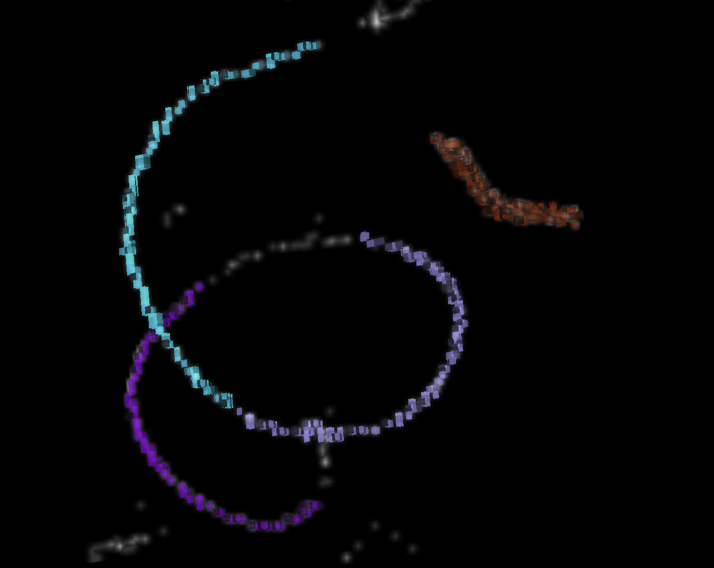
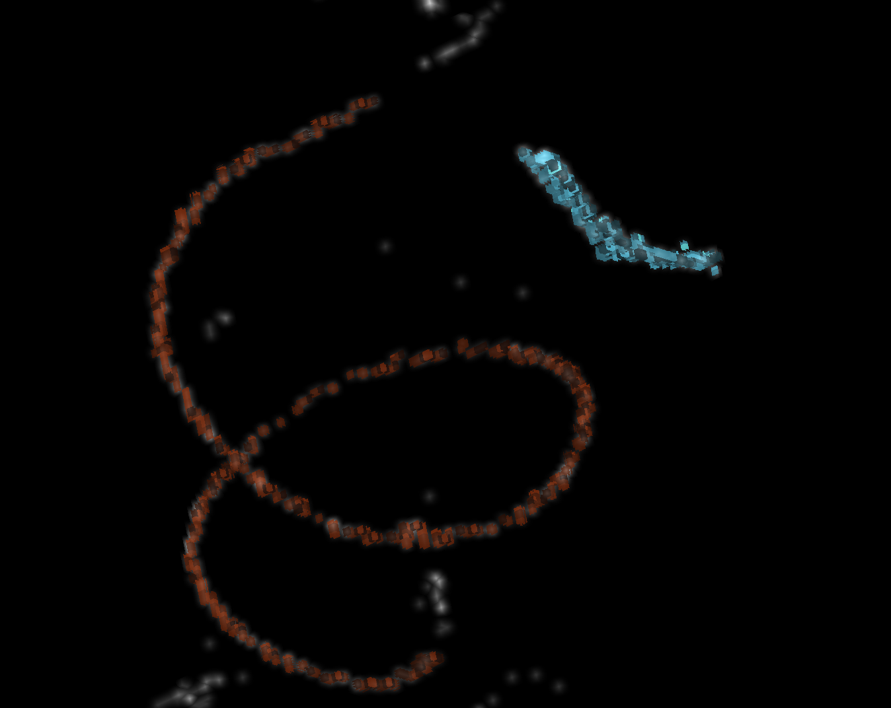
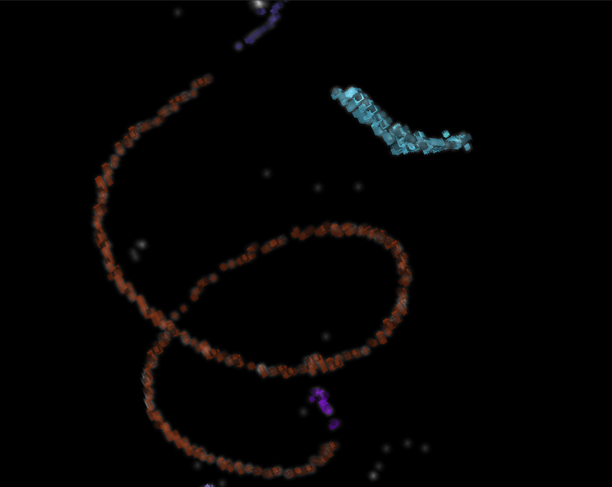

# Methods for the analysis of a segmented cochlea

This document shows the analysis of one segmented cochlea.

- Run the `python scripts/...` commands from the root of the repository.
- With `--s3`, a command reads the data from the S3 bucket. Paths such as `M_AMD_N162_L/tables/SGN_v2/default.tsv` are then relative to the bucket.
- Without `--s3`, give the local path, for example in a local MoBIE project.

## Labeling components

`flamingo_tools.label_components` finds the connected components of a segmentation table.
The labeling of SGN components usually needs no tuning:
```bash
flamingo_tools.label_components -i M_AMD_N162_L/tables/SGN_v2/default.tsv -o M_AMD_N162_L_v2.tsv --s3
```

- Add `--napari` to show the components in napari.
- Add `--cell_type ihc` for an IHC segmentation.

The labeling of IHC components often needs tuning of `--max_edge_distance` and `--min_component_length`.
The example below shows this iterative process.

### Example

Start with the default parameters and show the result in napari:
```bash
flamingo_tools.label_components --input M_AMD_N162_L/tables/IHC_v4b/default.tsv --napari --s3 -o M_AMD_N162_L_v4b.tsv --cell_type ihc
```

Most IHCs are segmented correctly, but there are gaps between the labeled components:
- The gap between component 2 (light blue) and component 3 (light violet) is small.
- The section between component 3 and component 4 (dark violet) is segmented, but it is not part of a connected component.

Increase `--max_edge_distance` (default 30 micrometer) to close these gaps.
A value of 50 or 70 micrometer usually gives a good result.

```bash
flamingo_tools.label_components --input M_AMD_N162_L/tables/IHC_v4b/default.tsv --napari --s3 -o M_AMD_N162_L_v4b.tsv --cell_type ihc --max_edge_distance 70 --force
```

The gap between component 2 and component 3 is closed.
Components 2, 3, and 4 and the section between components 3 and 4 are now one component.

Some IHC instances at the top and at the bottom of the main component are isolated. The white and grey overlay shows them.
These groups have too few IHCs for a connected component.
Decrease `--min_component_length` (default 50 instances) to include them.
The minimum value is 2. An estimate of the number of IHCs helps to keep the result clear.
```bash
flamingo_tools.label_components --input M_AMD_N162_L/tables/IHC_v4b/default.tsv --napari --s3 -o M_AMD_N162_L_v4b.tsv --cell_type ihc --max_edge_distance 70 --min_component_length 20 --force
```

The IHC spiral consists of components 1, 4, and 5.
Move the pointer over a component in napari to see its label.

Add the list of components with `-c` to show the number of IHCs.
The order of the components 4, 1, and 5 is not important here, but the tonotopic mapping needs the order of the components in the cochlea.
```bash
flamingo_tools.label_components --input M_AMD_N162_L/tables/IHC_v4b/default.tsv --s3 -o M_AMD_N162_L_v4b.tsv --cell_type ihc --max_edge_distance 70 --min_component_length 20 -c 4 1 5 --force
```
Output in the terminal:
```
Total IHCs: 926
Component 4 has 21 instances.
Component 1 has 511 instances.
Component 5 has 21 instances.
Custom component(s) have 553 IHCs.
```
The selected components can contain other structures than IHCs.
Examine the components in MoBIE to make sure that they contain only IHCs.

## Tonotopic mapping

`flamingo_tools.tonotopic_mapping` assigns a frequency to each instance of a segmentation table.
The frequency comes from the Greenwood function, and its parameters are different for mouse and gerbil.
Set the animal with `--animal` (`mouse` or `gerbil`, default `mouse`).
If the segmentation has more than one connected component, give the components with `-c` in their order in the cochlea.
```bash
flamingo_tools.tonotopic_mapping -i M_AMD_N162_L_v4b.tsv --cell_type ihc --animal mouse -c 4 1 5
```
The input is the table from the component labeling.
The command adds new columns and does not change the existing columns.
Without `-o`, the command overwrites the input table.

`--path_method` selects the method that finds the central path through the segmentation:
- `edt_refined` is the default for SGNs. It moves the path to the center of the cross-sections of Rosenthal's canal.
- `graph` is the default for IHCs. It follows the row of cells.
- `edt` is the method of the CochleaNet paper. Use it to reproduce the mapping of the paper.

Across the local cochleae, the `edt_refined` path is 3 % shorter than the `edt` path (median).
For single cochleae, the difference is between 8 % shorter and 37 % longer.
Thus the run length and the frequency are different for the two methods.
Map all cochleae of a cohort with the same method. Do not mix the results of the two methods in one analysis.

The run length of an IHC segmentation with more than one component has changed.
The command now measures each component of the component list over its full length.
Before, it measured only the section between the nodes that connect a component to its neighbors.
This gave a run length that was too short, in one case by a factor of two.

## Intensity annotation

The analysis of optogenetic therapy and of SGN subtypes uses the intensity of stains in each SGN instance.
The evaluation uses the full cochlea, but manual thresholds on subvolumes are sufficient.
The thresholds of the subvolumes apply to the full cochlea.
The process has four steps:

1) Extract equidistant crops along the segmentation.
2) Calculate the object measures of the stains for each instance of the segmentation.
3) Threshold the crops manually to classify the instances as positive or negative.
4) Apply the thresholds to the full cochlea.

### 1 - Extraction of regions of interest (ROI) blocks

The blocks give the thresholds for positive and negative instances.

Create a JSON file with the parameters of the block extraction:
```bash
flamingo_tools.json_block_extraction -o M_AMD_N162_L.json -d M_AMD_N162_L -i PV SGN_v2 --cell_type sgn -c 1 -n 6 --roi_halo 256 256 64 -s SGN_v2
```
Extract the blocks with this JSON file:
```bash
# data on the S3 bucket
flamingo_tools.extract_central_blocks --input M_AMD_N162_L.json -o <output_dir> --s3
# data in a local MoBIE project
flamingo_tools.extract_central_blocks --input M_AMD_N162_L.json -o <output_dir> --mobie_dir <mobie_project_dir>
```

#### Step-by-Step
You can also do the two parts of `flamingo_tools.extract_central_blocks` one after the other.

`flamingo_tools.equidistant_centers` finds coordinates at equal distances along the center of Rosenthal's canal (SGN) or along the IHC segmentation.
With `--json_info`, the command writes the coordinates as `crop_centers` into the JSON file:
```bash
flamingo_tools.equidistant_centers --json_info M_AMD_N162_L.json --s3
```
`flamingo_tools.extract_block` then extracts one block for each crop center and image channel of the JSON file:
```bash
flamingo_tools.extract_block --json_info M_AMD_N162_L.json -o <output_dir> --s3
```
To extract one block, give the image data and the center coordinate in micrometer:
```bash
flamingo_tools.extract_block --input M_AMD_N162_L/images/ome-zarr/SGN_v2.ome.zarr -o crop.tif -c x y z --s3
```

### 2 - Calculation of object measures

Calculate the intensity of the stain in each SGN instance before the thresholding in napari.
`flamingo_tools.object_measures` accepts the JSON file of the block extraction as input.
The location of the output depends on the arguments:
- With `--mobie_dir`, the command writes the tables into the local MoBIE project, as `<mobie_project>/<cochlea>/tables/<seg_name>/<stain>_<seg_name>_object-measures.tsv`.
- With an output directory `-o`, the command writes `<cochlea>_<stain>_<seg_name>_object-measures.tsv` into this directory.
- Without `--json_info`, give one output file for each image path with `-o`.

```bash
# write the tables into the local MoBIE project
flamingo_tools.object_measures --mobie_dir <mobie_dir> --json_info M_AMD_N162_L.json

# read the data from the S3 bucket and write the tables into an output directory
flamingo_tools.object_measures -o <output_dir> --json_info M_AMD_N162_L.json --s3

# calculate the PV object measures without a JSON file
flamingo_tools.object_measures -o M-AMD-N162-L_PV_SGN-v2_object-measures.tsv \
    -i M_AMD_N162_L/images/ome-zarr/PV.ome.zarr \
    --seg_table M_AMD_N162_L/tables/SGN_v2/default.tsv \
    --seg_path M_AMD_N162_L/images/ome-zarr/SGN_v2.ome.zarr \
    --s3
```

`--bg_mask` calculates the object measures with a background mask.
A parameter file can also enable the background mask with `"use_bg_mask": "yes"` in its `object_measures` section.
The command calculates the background mask on the fly and does not save it, unless `--bg_cache_paths` gives a location:
- With `--json_info`, a directory receives one mask for each image channel.
- Explicit paths need one path for each image channel. Without `--json_info`, give one path for each image path.

The next run then uses the saved masks again.

The parameter file gives the paths of the images, the segmentation, and the table.
Use `-i`, `--seg_path` and `--seg_table` only to override these paths. Then give one image path for each channel.
The parameter file in this example enables the background mask:
```bash
flamingo_tools.object_measures \
    --json_info reproducibility/processing/M_LR_000144_L_SGN.json \
    --bg_cache_paths bg_masks \
    -o . --s3
```


#### 2a - For subtype analysis
Use the script `scripts/measurements/sgn_subtype_ratio.py` to calculate the ratio of subtype stains to a reference stain, for example the ratio of Calb1 and Ntng1 to PV.
Before you run the script, add the parameters of the cochlea to `flamingo_tools/postprocessing/sgn_subtype_utils.py`.
This makes the process reproducible.

### 3 - Manual intensity thresholding
The annotation needs these crops:
- GFP: the crops of PV, GFP, and SGN.
- Alphatag: the crops of Vglut3, Alphatag, IHC, and optionally Otof.

The names of the crop files must have the format `<cochlea>_crop_xxx-yyy-zzz_<image_channel>.tif`.
Start the annotation tool in napari with the common prefix `<cochlea>_crop_xxx-yyy-zzz` of all crops.
The tool selects the GFP or the Alphatag scenario from the stain files with this prefix.

`--meas_table` is the directory with the object-measures tables of the channels, for example `<mobie_project>/<cochlea>/tables/<seg_name>`.
The tool finds the table of each channel by its file name prefix, for example `Alphatag_IHC-v11_object-measures-bg-mask.tsv` or `Otof_IHC-v11_object-measures-bg-mask.tsv`.
```bash
python scripts/intensity_annotation/intensity_annotation.py --meas_table <object_measures_dir> --prefix <common_prefix>
```
In the Alphatag scenario, the thresholding has two steps:
1) Threshold the Alphatag expression.
2) If the Otof crop is present, select Otof in the channel selection box at the top right of the napari window. Then threshold Otof.

The histogram, the threshold slider, and the visible image layer follow the selected channel.

For each crop and channel, the analysis needs two segmentations. Each segmentation divides the instances into two groups with a threshold:
1) The first segmentation separates the clearly negative instances from all instances that can be positive.
Its name is `<cochlea>_crop_<crop-coords>_<stain>_allWeakPositiveIncluded_<suffix>.tif`.
2) The second segmentation separates the clearly positive instances from all instances that can be negative.
Its name is `<cochlea>_crop_<crop-coords>_<stain>_allNegativeExcluded_<suffix>.tif`.

Note: You can select the suffix freely. The other parts of the name are necessary.

The next step calculates the threshold as a mean value between the two groups: the clearly negative and the clearly positive instances.

### 4 - Analysing the marker annotation
Put the thresholding files of one annotator into one directory.
Give this directory with the argument `-a, --annotation_dirs`.
If more than one annotator annotated the same crops, give one directory for each annotator.
The script searches all directories for the annotations of the given cochleae.
An annotator does not have to annotate every crop.
The script writes a summary of the intensities of all crops and annotators to `<cochlea>_<stain>_<seg_name>_annotations.tsv`.

```bash
python scripts/measurements/eval_marker_annotations.py -c M_LR_000143_L \
    -o <output_dir> -t <threshold_dir> \
    -a <annotation_dir>/Results{LR,AMD,EK} \
    --seg_name SGN_v2 --marker_name GFP --s3
```
This command is equal to the command above, but it gives the input paths explicitly:
```bash
python scripts/measurements/eval_marker_annotations.py -c M_LR_000143_L \
    -o <output_dir> -t <threshold_dir> \
    -a <annotation_dir>/Results{LR,AMD,EK} \
    --seg_data M_LR_000143_L/images/ome-zarr/SGN_v2.ome.zarr \
    --seg_table M_LR_000143_L/tables/SGN_v2/default.tsv \
    --meas_table M_LR_000143_L/tables/SGN_v2/GFP_SGN-v2_object-measures.tsv \
    --seg_name SGN_v2 --marker_name GFP --s3
```
The script can also read local data.
If the paths have the structure of the previous command, `--mobie_dir` is sufficient:
```bash
python scripts/measurements/eval_marker_annotations.py -c M_LR_000143_L \
    -o <output_dir> -t <threshold_dir> \
    -a <annotation_dir>/Results{LR,AMD,EK} \
    --mobie_dir <local_mobie_dir> \
    --seg_name SGN_v2 --marker_name GFP
```
Without an output directory, the script writes the table to `<mobie_project>/<cochlea>/tables/<seg_name>/<marker_name>_<seg_name>.tsv`.

`--column` selects the column of the measurement table for the threshold.
`--bg_mask` reads the object measures that use a background mask.
The threshold rule does not change: the threshold is the value between the clearly positive and the clearly negative population, measured on the selected column.

`-t, --threshold_save_dir` saves the thresholds as `<cochlea>_<stain>_<seg_name>.json`.
For each crop, this file contains:
- `median_intensity`: the threshold averaged over all annotators.
- `annotator_intensities`: the threshold of each annotator.

The annotator name is the name of the annotation directory, for example `ResultsAMD`.

#### Variability between annotators
`--variance` evaluates how much the marker assignment depends on the annotator.
The script applies the thresholds of each annotator to the full cochlea. This gives one scenario for each annotator.
The script compares these scenarios with each other and with the `median` scenario.
The `median` scenario uses the thresholds averaged over all annotators.
If an annotator has no threshold for a crop, the scenario of this annotator does not include the crop.

The script saves the result as `<cochlea>_<stain>_<seg_name>_variance.json` in the threshold directory.
Without a threshold directory, the script uses the output directory.
The file contains:
- the percentage of positive and negative instances for each scenario,
- the variance of these percentages over all annotators,
- the values for each crop.

### 4a - Subtype analysis
The subtype analysis works like the marker annotation:
```bash
python scripts/measurements/eval_subtype_annotations.py -c M_LR_N152_L \
    -o <output_dir> -t <threshold_dir> \
    -a <annotation_dir>/Results{LR,AMD,EK} \
    --s3
```
The script processes the cochlea for each subtype stain in the `COCHLEAE` dictionary of `flamingo_tools/postprocessing/sgn_subtype_utils.py`.
`--variance` writes one threshold variance file for each stain, `<cochlea>_<stain>_<seg_name>_variance.json`.
The file has the same format as the file of the marker annotation.

A custom threshold in `CUSTOM_THRESHOLDS` can override the annotations of a stain.
The `median` scenario then still uses the annotated thresholds, so that the comparison stays between the annotators.
The item `custom_thresholds` records this case.

#### Variability of the subtypes
A pair of stains gives a subtype, see `STAIN_TO_TYPE` in `flamingo_tools/postprocessing/sgn_subtype_utils.py`.
To evaluate the variability of the subtypes, give the directory with the threshold variance files to `scripts/assign_subtypes.py`:
```bash
python scripts/assign_subtypes.py -c M_LR_N152_L -o <output_dir> --variance <variance_dir>
```
The script searches the directory for the default file name of each subtype stain of the cochlea.
For the files that it finds, the script applies the thresholds of each annotator to the full cochlea again.
Then it assigns the subtypes for this annotator only.

The script saves the result as `<cochlea>_subtypes_variance.json`. The file contains:
- the number and the percentage of instances for each subtype and annotator,
- the variance of the percentages over all annotators,
- the difference to the `median` scenario.

An annotator must annotate all stains of a pair. The script skips other annotators and shows a warning.


### 4b - Regenerating the OTOF marker labels
The per-crop thresholds of the four cochleae `M_AMD_OTOF27_L`, `M_AMD_OTOF27_R`, `M_AMD_OTOF28_L` and `M_AMD_OTOF28_R` are stored.
Thus the script can regenerate their marker labels without the annotation files.
The script `scripts/measurements/regenerate_otof_MAMDOTOF27_28_thresholds.py` contains two threshold sets and applies one of them.
Both sets threshold the `mean` of the object measures, but of different tables.

| set | argument | table |
|---|---|---|
| annotator | `--local_annotator` | `Otof_IHC-v11_object-measures-bg-mask.tsv` |
| optimal | `--local_optimal` | `Otof_IHC-v11_object-measures.tsv` |

The annotator set uses the value between the clearly positive and the clearly negative population of each crop, averaged over both annotators.
`get_crop_parameters` applies the same rule to an annotated crop.
Thus each value of this set comes from the annotations, and this set is the reference.

The optimal set comes from a leave-one-instance-out sweep on the plain `mean`, with a weight of three for each positive instance.
This set agrees slightly better with the annotated calls, but it does not come from a rule that you can apply by hand.

```bash
python scripts/measurements/regenerate_otof_MAMDOTOF27_28_thresholds.py \
    --local_annotator --s3 -o <output_dir>
```
The fraction of positive IHCs:

| cochlea | annotator | optimal |
|---|---|---|
| M_AMD_OTOF27_L | 16.34 % | 17.10 % |
| M_AMD_OTOF27_R | 0.00 % | 0.00 % |
| M_AMD_OTOF28_L | 33.99 % | 37.92 % |
| M_AMD_OTOF28_R | 17.61 % | 17.92 % |

The assignment uses the same principle as step 4:
- The script maps each crop center to the `length_fraction` of the cochlea.
- Each crop sets the threshold of a band. The band ends at the middle of the distance to the neighbor crop.

The mapping uses only the instances of the connected components.
An instance outside of these components has the placeholder length fraction 0. This value would move the crop positions toward the start of the cochlea.
Thus the segmentation table must have the columns `component_labels` and `length_fraction`.
The component labeling and the tonotopic mapping add these columns.
An instance with a `length_fraction` of exactly 0 or 1 is between the bands and stays unassigned. This applies to a few instances in each cochlea.

`M_AMD_OTOF27_R` is an untreated control.
The thresholds of its crops are above all measured values, so the full cochlea is negative.
The same applies to the crop `0397-0162-0613` of `M_AMD_OTOF28_R`.

For each cochlea, the script writes:
- `<cochlea>_Otof_IHC-v11.tsv` with the assignment in the column `marker_labels`,
- a JSON file with the thresholds and the counts for each band,
- a plot of the `mean` over the length fraction, with one threshold line for each band.

The labels are 1 for a positive instance and 2 for a negative instance.
An instance outside the components or without an object measure has the label 0.

Note on the object measures: a table that `--bg_mask` calculated before the fix of `_normalize_background` is not correct.
Its median has no background subtraction.
Each other statistic has the subtraction of its own background statistic, not of one background level.
Calculate such a table again before you threshold it.

### Example for standard output table

Limit the segmentation table to the instances of specific components to make the analysis easier.
These are one component, or more than one component if the cochlea is broken.
Keep the other entries, because they can be necessary for a later analysis.
For this reason, `scripts/analysis/create_main_table.py` creates a separate table with the main parameters.
It uses the `default.tsv` segmentation table and the object measures.

#### Changes for the main table
The main table:
- adds the column `volume[µm³]`, which is the column `n_pixels` multiplied by the voxel volume.
- renames the column `offset` of the segmentation table to `dist_from_center[µm]` for SGNs. This column contains the distance from the center to Rosenthal's canal.
- includes the mean intensity in each cell, if you give a table with object measures.

The calculation of the background-subtracted mean intensity takes a long time.
Test the script without it first.

#### Not yet included
The main table does not include the columns of the colocalization thresholding.
The scripts `scripts/measurements/eval_marker_annotations.py` and `scripts/measurements/eval_subtype_annotations.py` add these columns separately (see above):
- `marker_labels` for GFP and rbOtof,
- `marker_<stain>` for the subtypes,
- `subtype_label` for the subtype analysis.

#### Example
These commands process the cochlea `M_LR_000153_L` of the publication:

```bash
# label components
flamingo_tools.label_components -i MLR153L_default.tsv -o MLR153L_labeled.tsv --cell_type sgn -c 1 2 3

# tonotopic mapping
flamingo_tools.tonotopic_mapping -i MLR153L_labeled.tsv -o MLR153L_tonotopic.tsv --cell_type sgn -c 1 2 3 --animal mouse

# create a JSON file as input for the next steps
flamingo_tools.json_block_extraction -o M_LR_000153_L.json -d M_LR_000153_L -i PV CR GFP SGN_v2 --cell_type sgn -c 1 2 3 -n 6 --roi_halo 256 256 64 -s SGN_v2

# object measures without a background mask
flamingo_tools.object_measures -o . --json_info M_LR_000153_L.json --s3

# object measures with a background mask
flamingo_tools.object_measures -o . --json_info M_LR_000153_L.json --s3 --bg_mask

# explicit paths for one stain (PV) with a background mask
flamingo_tools.object_measures -o M-LR-000153-L_PV_SGN-v2_object-measures-bg-mask.tsv --image_paths M_LR_000153_L/images/ome-zarr/PV.ome.zarr --seg_table M_LR_000153_L/tables/SGN_v2/default.tsv --seg_path M_LR_000153_L/images/ome-zarr/SGN_v2.ome.zarr -c 1 2 3 --bg_mask --s3

# main table with object measures
python scripts/analysis/create_main_table.py --input MLR153L_tonotopic.tsv \
    --json_info M_LR_000153_L.json \
    --meas_tables M-LR-000153-L_GFP_SGN-v2_object-measures-bg-mask.tsv M-LR-000153-L_PV_SGN-v2_object-measures.tsv M-LR-000153-L_GFP_SGN-v2_object-measures.tsv M-LR-000153-L_CR_SGN-v2_object-measures.tsv \
    --output MLR153L_filtered.tsv
```

## Synapse colocalization

`scripts/measurements/synapse_colocalization.py` compares the synapses of a co-stain with the synapses of a reference stain.
The co-stain is the test stain, for example Homer1, Bsn, or RibA. The reference stain is usually CtBP2.
The input tables are the synapse detections that are mapped to the IHCs, with the coordinates `x`, `y`, `z` in micrometer and the column `matched_ihc`.
The script matches the synapses one to one. `--max_dist` sets the maximum distance of a match (default 2 micrometer).

The test stain takes the role of the detections and the reference stain takes the role of the ground truth:
- `recall` is the fraction of reference synapses with a test partner.
- `precision` is the fraction of test synapses with a reference partner.
- `accuracy` is TP / (TP + FP + FN), because point matching has no true negatives.

Give `--ihc_table` to use only the synapses of valid IHCs.
`-c` selects the valid IHCs by their value in `--ihc_column` (default `component_labels`).
Without `--ihc_table`, the script uses all synapses, also the synapses of instances outside the IHC components.

### Example

The cochlea `M_AMD_000117_L` has the stains CtBP2 and Homer1.
The IHC_v11 table on the bucket has no component labels yet.
Thus, first label the components with the parameters of the processing file:
```bash
flamingo_tools.label_components --json_info reproducibility/processing/M_AMD_000117_L_IHC.json -o M_AMD_000117_L_IHC_v11.tsv --s3
```
The command reads the table from the bucket and writes the output locally.
`--s3` applies to all tables of the colocalization script, so copy the synapse tables to the same location:
```bash
rclone copyto cochlea-lightsheet:cochlea-lightsheet/M_AMD_000117_L/tables/synapse_v3_ihc_v11/default.tsv M_AMD_000117_L_synapse_v3_ihc_v11.tsv
rclone copyto cochlea-lightsheet:cochlea-lightsheet/M_AMD_000117_L/tables/Homer1_synapse_v3_ihc_v11/default.tsv M_AMD_000117_L_Homer1_synapse_v3_ihc_v11.tsv
```
Then compare Homer1 with CtBP2 on the IHCs of the components 1, 3, and 2:
```bash
python scripts/measurements/synapse_colocalization.py \
    -r M_AMD_000117_L_synapse_v3_ihc_v11.tsv \
    -t M_AMD_000117_L_Homer1_synapse_v3_ihc_v11.tsv \
    --ihc_table M_AMD_000117_L_IHC_v11.tsv -c 1 3 2 \
    -o M_AMD_000117_L_Homer1_colocalization.json \
    --ihc_counts M_AMD_000117_L_Homer1_ihc_counts.tsv
```
The script writes the result to the JSON file and to the terminal:
```
"n_synapses_reference": 7755,
"n_synapses_test": 14857,
"n_ihcs": 651,
"n_ihcs_reference": 523,
"n_ihcs_test": 589,
"n_ihcs_shared": 522,
"tp": 7208,
"fp": 7649,
"fn": 547,
"precision": 0.485,
"recall": 0.929,
"f1-score": 0.638,
"accuracy": 0.468
```
93 % of the CtBP2 synapses have a Homer1 partner, but only 49 % of the Homer1 synapses have a CtBP2 partner.
- `n_ihcs` is the number of valid IHCs.
- `n_ihcs_reference` and `n_ihcs_test` are the numbers of IHCs with at least one synapse of the stain.
- `n_ihcs_shared` is the number of IHCs with synapses of both stains.

The table of `--ihc_counts` has one row for each valid IHC, also for an IHC without synapses.
Its columns are `label_id`, `n_reference`, `n_test`, and `n_matched`.
A matched pair counts for the IHC of its reference synapse.

After the upload of the labeled IHC table, all three tables are on the bucket. Then give the bucket paths and `--s3`.

### RibA and CTBP2 of M_LR_000215_R

The older tables of `M_LR_000215_R` mark the valid IHCs with the column `is_ihc`:
```bash
python scripts/measurements/synapse_colocalization.py \
    -r M_LR_000215_R/tables/CTBP2_synapse_v3_ihc_v4b/default.tsv \
    -t M_LR_000215_R/tables/RibA_synapse_v3_ihc_v4b/default.tsv \
    --ihc_table M_LR_000215_R/tables/IHC_v4b/default.tsv --ihc_column is_ihc -c 1 \
    -o M_LR_000215_R_RibA_colocalization.json --s3
```
The result has 486 valid IHCs, 6701 CTBP2 synapses, 3371 RibA synapses, and 3119 matched pairs.
Thus, 92.5 % of the RibA synapses and 46.5 % of the CTBP2 synapses colocalize.
The docstring of `fig_06d` in `scripts/figures/plot_fig6.py` has the same numbers, but with the two stains swapped.

## Upload the tables to the S3 bucket

Copy the tables of the analysis to the S3 bucket with `rclone`.
See [Data transfer from/to the S3 bucket](https://github.com/computational-cell-analytics/slurm-workflows/blob/main/doc/hpc_02_data_transfer.md#data-transfer-fromto-the-s3-bucket) in slurm-workflows for the setup of `rclone`.
```bash
# segmentation table with the component labels, see Labeling components
rclone --progress copyto M_AMD_N162_L_v2.tsv cochlea-lightsheet:cochlea-lightsheet/M_AMD_N162_L/tables/SGN_v2/default.tsv
# object measures: the name on the bucket has no cochlea prefix
rclone --progress copyto M-AMD-N162-L_PV_SGN-v2_object-measures.tsv cochlea-lightsheet:cochlea-lightsheet/M_AMD_N162_L/tables/SGN_v2/PV_SGN-v2_object-measures.tsv
```

**Upload a segmentation table only if you made it from the current table on the bucket. Otherwise, you delete the columns of a later analysis, for example `marker_labels`.**
